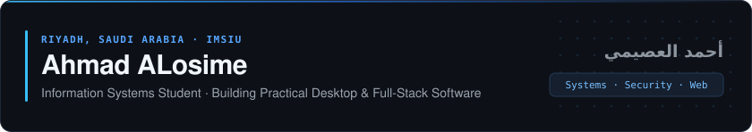

  <picture>
    <source media="(prefers-color-scheme: dark)" srcset="./assets/header-dark.svg" />
    <source media="(prefers-color-scheme: light)" srcset="./assets/header-light.svg" />
    
  </picture>

 

Information Systems student at **Imam Muhammad ibn Saud Islamic University (IMSIU)** in Riyadh, Saudi Arabia. I build practical desktop and full-stack web software with a focus on reliability, security boundaries, and understanding how systems work underneath the abstractions.

Alongside software development, I have held student leadership responsibilities—including leading the **IEEE IMSIU Student Branch**, where I oversaw technical workshops, modernized branch operations, and built its web infrastructure.

---

### Featured Projects

  <a href="https://github.com/A-ALOSIME/kinana">
    <picture>
      <source media="(prefers-color-scheme: dark)" srcset="./assets/card-kinana-dark.svg" />
      <source media="(prefers-color-scheme: light)" srcset="./assets/card-kinana-light.svg" />
      
    </picture>
  </a>
  &nbsp;
  <a href="https://github.com/A-ALOSIME/LUB">
    <picture>
      <source media="(prefers-color-scheme: dark)" srcset="./assets/card-lub-dark.svg" />
      <source media="(prefers-color-scheme: light)" srcset="./assets/card-lub-light.svg" />
      
    </picture>
  </a>

  <a href="https://github.com/A-ALOSIME/IEEE-IMSIU/tree/feat/production-admin">
    <picture>
      <source media="(prefers-color-scheme: dark)" srcset="./assets/card-ieee-dark.svg" />
      <source media="(prefers-color-scheme: light)" srcset="./assets/card-ieee-light.svg" />
      
    </picture>
  </a>

| Project | Overview & Scope | Stack & Tags | Links |
| :--- | :--- | :--- | :--- |
| **[Kinana](https://github.com/A-ALOSIME/kinana)** | Offline-first desktop password manager with authenticated AES-256-GCM encryption, Argon2id key derivation, crash-safe write-ahead journaling, zero network telemetry, and OS credential auto-unlock (Windows/Linux). Windows & Linux Stable, macOS Preview. | `Desktop` `Security` `Open Source`   Rust · Tauri 2 · React · TypeScript | [Source](https://github.com/A-ALOSIME/kinana) · [Releases (`v0.1.17`)](https://github.com/A-ALOSIME/kinana/releases) |
| **[LUB \| لُبّ](https://github.com/A-ALOSIME/LUB)** | University student clubs and councils platform for club discovery, memberships, events, volunteer hours, and role-scoped administration. Collaborative graduation project by **Ahmad Alosime & Nasser Al-Yamani** (in active development). | `Full-Stack` `Collaborative`   Next.js · TypeScript · PostgreSQL · Drizzle · Supabase · Cloudflare Workers | [Source](https://github.com/A-ALOSIME/LUB) · [lub.community](https://lub.community) |
| **[IEEE IMSIU](https://github.com/A-ALOSIME/IEEE-IMSIU)** | Bilingual (Arabic RTL / English) public site and role-based operations portal for the IEEE Student Branch at IMSIU, covering events, registrations, memberships, committees, and email delivery. Production app on `feat/production-admin`. | `Web Platform` `Edge`   Astro · TypeScript · Tailwind CSS · Cloudflare Workers / D1 / R2 | [Production Branch](https://github.com/A-ALOSIME/IEEE-IMSIU/tree/feat/production-admin) · [Repo](https://github.com/A-ALOSIME/IEEE-IMSIU) · [ieeeimsiu.com](https://ieeeimsiu.com) |

---

### Technology Stack

| Category | Technologies |
| :--- | :--- |
| **Languages** |       |
| **Frameworks & UI** |      |
| **Data & Infrastructure** |      |
| **Developer Tools** |     |

---

### Focus & Leadership

- **Systems, Security & Quality:** Interested in how applications behave under real constraints—local-first persistence, explicit threat-model boundaries, memory footprint, and crash-safe state transitions.
- **End-to-End Product Engineering:** Working across relational schema design, role-based access control, bilingual Arabic/English interfaces, automated testing, and edge deployments.
- **Student Leadership (IEEE IMSIU):** Led the university's IEEE Student Branch, coordinating technical workshops, structuring team workflows, and shipping the branch's production web platform.

---

### Connect

  
  
  
  

