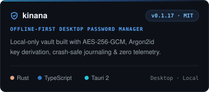
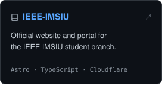
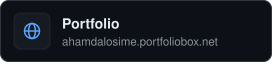

### Ahmad ALosime

I'm an Information Systems student at IMSIU with a focus on cybersecurity. I have experience with software projects and digital forensics, and I currently serve as President of the IEEE IMSIU Student Branch.

<h3>
  <a href="https://github.com/A-ALOSIME?tab=repositories"><picture><source media="(prefers-color-scheme: dark)" srcset="./assets/stars-dark.svg" /><source media="(prefers-color-scheme: light)" srcset="./assets/stars-light.svg" /></picture></a>Featured Projects
</h3>

  <a href="https://github.com/A-ALOSIME/kinana"><picture><source media="(prefers-color-scheme: dark)" srcset="./assets/card-kinana-dark.svg" /><source media="(prefers-color-scheme: light)" srcset="./assets/card-kinana-light.svg" /></picture></a>&nbsp;&nbsp;<a href="https://github.com/A-ALOSIME/LUB"><picture><source media="(prefers-color-scheme: dark)" srcset="./assets/card-lub-dark.svg" /><source media="(prefers-color-scheme: light)" srcset="./assets/card-lub-light.svg" /></picture></a>&nbsp;&nbsp;<a href="https://github.com/A-ALOSIME/IEEE-IMSIU"><picture><source media="(prefers-color-scheme: dark)" srcset="./assets/card-ieee-dark.svg" /><source media="(prefers-color-scheme: light)" srcset="./assets/card-ieee-light.svg" /></picture></a>

### Technologies

  
  
  
  
  
  

### Connect

  <a href="https://www.linkedin.com/in/a-alosime/"><picture><source media="(prefers-color-scheme: dark)" srcset="./assets/connect-linkedin-dark.svg" /><source media="(prefers-color-scheme: light)" srcset="./assets/connect-linkedin-light.svg" /></picture></a>&nbsp;&nbsp;<a href="https://ahamdalosime.portfoliobox.net/"><picture><source media="(prefers-color-scheme: dark)" srcset="./assets/connect-portfolio-dark.svg" /><source media="(prefers-color-scheme: light)" srcset="./assets/connect-portfolio-light.svg" /></picture></a>

