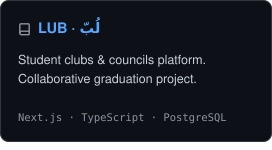
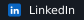
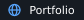

### Ahmad ALosime

Information Systems student at Imam Muhammad ibn Saud Islamic University (IMSIU) in Riyadh, Saudi Arabia. I build desktop and web software, enjoy understanding how systems work, and care about writing clean, reliable code.

Outside of coursework, I have led student technical initiatives at university, including the IEEE IMSIU Student Branch.

### Featured Projects

  <a href="https://github.com/A-ALOSIME/kinana"><picture><source media="(prefers-color-scheme: dark)" srcset="./assets/card-kinana-dark.svg" /><source media="(prefers-color-scheme: light)" srcset="./assets/card-kinana-light.svg" /></picture></a>&nbsp;&nbsp;<a href="https://github.com/A-ALOSIME/LUB"><picture><source media="(prefers-color-scheme: dark)" srcset="./assets/card-lub-dark.svg" /><source media="(prefers-color-scheme: light)" srcset="./assets/card-lub-light.svg" /></picture></a>&nbsp;&nbsp;<a href="https://github.com/A-ALOSIME/IEEE-IMSIU"><picture><source media="(prefers-color-scheme: dark)" srcset="./assets/card-ieee-dark.svg" /><source media="(prefers-color-scheme: light)" srcset="./assets/card-ieee-light.svg" /></picture></a>

  

### Technologies

  
  
  
  
  
  

### Connect

  &nbsp;

